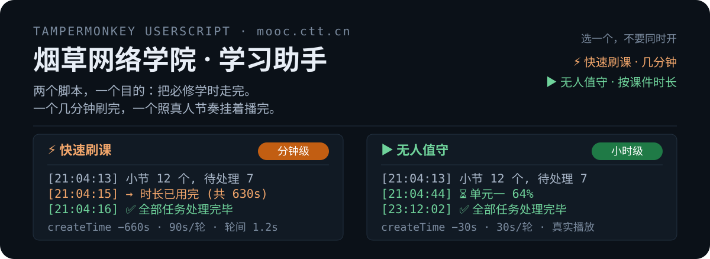
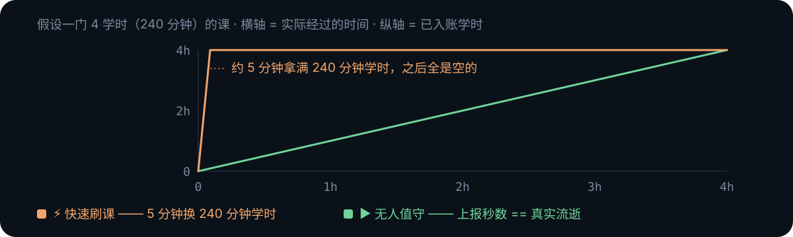
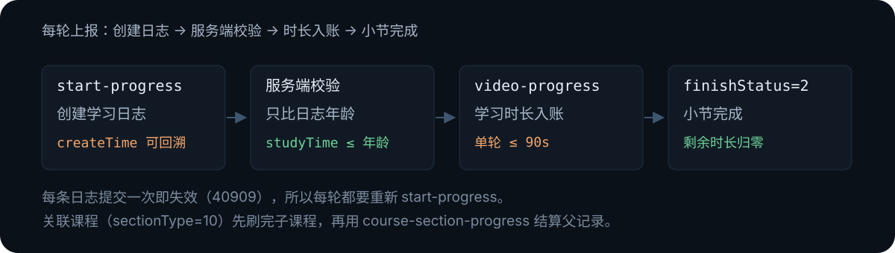

<p align="center">
  
</p>

# 烟草网络学院 · 学习助手

两个 Tampermonkey 用户脚本，跑在 `mooc.ctt.cn` 页面里，用你自己的登录态把必修学时走完。

- **⚡ 快速刷课** —— 回填 `createTime`、批量上报，一门课几分钟刷完
- **▶ 无人值守** —— 真实播放课件，上报秒数 == 真实流逝秒数，节奏与真人一致

装一个就够。非官方工具，用之前先看一遍「边界与风险」。

## 安装

### 1. 装一个油猴扩展（三选一）

| 扩展 | 地址 |
| :-- | :-- |
| Tampermonkey（篡改猴） | [Chrome 应用商店](https://chrome.google.com/webstore/detail/tampermonkey/dhdgffkkebhmkfjojejmpbldmpobfkfo) |
| Violentmonkey（暴力猴） | [Chrome 应用商店](https://chromewebstore.google.com/detail/violentmonkey/jinjaccalgkegednnccohejagnlnfdag) |
| ScriptCat（脚本猫） | [Chrome 应用商店](https://chrome.google.com/webstore/detail/scriptcat/ndcooeababalnlpkfedmmbbbgkljhpjf) |

### 2. 开启用户脚本权限

Chrome 138 起把用户脚本收进了独立开关：打开 `chrome://extensions` → 找到刚装的扩展 →「详情」→
打开**允许运行用户脚本**。多数版本只需要这一下；个别版本还要先开「开发者模式」或
「允许访问文件网址」，按提示给就行。不开这一步，脚本装上了也不会执行。

### 3. 装脚本（二选一）

**方式 A：商店一键安装**

| 模式 | GreasyFork | ScriptCat |
| :-- | :-- | :-- |
| ⚡ 快速刷课 · 学习助手 | [604497](https://greasyfork.org/zh-CN/scripts/604497-%E7%83%9F%E8%8D%89%E7%BD%91%E7%BB%9C%E5%AD%A6%E9%99%A2-%E5%BF%AB%E9%80%9F%E5%88%B7%E8%AF%BE%E5%AD%A6%E4%B9%A0%E5%8A%A9%E6%89%8B) | [9059](https://scriptcat.org/zh-CN/script-show-page/9059) |
| ▶ 无人值守 · 学习助手 | [604496](https://greasyfork.org/zh-CN/scripts/604496-%E7%83%9F%E8%8D%89%E7%BD%91%E7%BB%9C%E5%AD%A6%E9%99%A2-%E6%97%A0%E4%BA%BA%E5%80%BC%E5%AE%88%E5%AD%A6%E4%B9%A0%E5%8A%A9%E6%89%8B) | [9058](https://scriptcat.org/zh-CN/script-show-page/9058) |

**方式 B：复制源码粘贴（备用）**

商店打不开、或者想跟仓库保持同一份代码时用这条。打开源码链接 → 全页复制 →
点油猴图标 →「添加新脚本」（Tampermonkey 是 `+` 号，Violentmonkey 是「新建脚本」）→
粘贴覆盖模板 → `Ctrl+S` 保存。

| 模式 | 源码 |
| :-- | :-- |
| ⚡ 快速刷课 · 学习助手 | [tobacco-mooc-fast.user.js](https://github.com/moocctt/tobacco-mooc-study/raw/refs/heads/main/userscript/tobacco-mooc-fast.user.js) |
| ▶ 无人值守 · 学习助手 | [tobacco-mooc-unattended.user.js](https://github.com/moocctt/tobacco-mooc-study/raw/refs/heads/main/userscript/tobacco-mooc-unattended.user.js) |

复制时注意别漏掉第一行 `// ==UserScript==`——缺它扩展不认这份脚本，也不会报错，
只会在列表里显示为一条空白。

装好后打开 `mooc.ctt.cn` 任意页面，右下角出现悬浮面板，点「执行学习任务」即可。
登录态直接复用页面自己发出的令牌，不用填账号；顺手点一次油猴菜单的**保存账号密码**，
令牌 30 天过期后脚本能自动重登，不用手动刷页面。

> 两个脚本功能互斥，请勿同时开启。自动化脚本存在账号异常风险，请自行斟酌。

## 两种模式差在哪

<p align="center">
  
</p>

同一门 4 学时的课：快速刷课约 5 分钟，无人值守约 4 小时。两条路最终都到 100%，区别只在你愿不愿意花那些时间。

| | ⚡ 快速刷课 | ▶ 无人值守 |
| :-- | :-- | :-- |
| 每轮提交时长 | 90s（平台上限） | 30s |
| `createTime` 回填 | 660–900s | 30s（等于上报秒数） |
| 轮间等待 | 0.6–1.6s | 30s（真实流逝） |
| 播放行为 | 不播，直接上报 | 真实播放，静音 + 降到普清 |
| 适合 | 尽快清完 | 挂机，节奏与真人一致 |

**关于「600s/轮」**：发布页的 600s 指的是 `createTime` 回填档位（默认 600，油猴菜单可改），
不是单轮提交的时长。实际每轮提交的 `studyTime` 被平台硬上限卡在 90s——实测 ≥120s 会被静默丢弃。
所以快是快在两处：回填让剩余额度永远够用，轮间只歇 1 秒而不是 90 秒。

## 面板

悬浮窗可拖拽、可折叠，位置和折叠状态会记住。标题栏颜色取自页面自身顶栏，浅色底自动换深色字。
面板上依次是状态行（`课程 | 小节 | 轮 n | 已报 Ns`）、启动/停止按钮、滚动日志（保留最近 60 行）。

面板按钮会先看当前 URL：停在课程/专题详情页就只处理**这一门**，否则拉「我的任务」列表按课推进。
全部处理完（且不是配额耗尽）会在 2 秒后自动刷新页面，让进度条落到新值上。

油猴菜单里还有：

- **设置单档秒数**（≥30，仅快速刷课）—— 即 `createTime` 回填档位
- **自动续跑 开/关**（仅无人值守）—— 刷新或翻页后自动接着跑
- **设置单位名称** —— 重登时提交的 `company_name`，默认「全行业」
- **保存 / 清除账号密码**

## 它是怎么工作的

<p align="center">
  
</p>

整套东西只靠一个缺口：`createTime` 是给「离线学习记录回放」用的参数，服务端拿它算日志年龄，
然后只校验一件事——本次上报的时长不超过日志年龄。把 `createTime` 挪到过去，额度就凭空变多了。

完成判定则与播放进度无关：累计学时需达课件时长的 100%（`VIDEO_PALY_THRESHOLD=100`，播放进度阈值 0），
所以只要把 `remainingTime` 刷到 0 就算完成。

**令牌。** 脚本不自己造登录态，两条路拿 `Authorization`：读 `localStorage.token` 拼成 `Bearer__<access_token>`
（注意是双下划线，单空格会 401），以及挂钩 `XMLHttpRequest.prototype.setRequestHeader` 和 `window.fetch`，
从页面自己发出的请求里截 `Bearer` 头。

**失效自愈。** 遇到 `401` 或 `errorCode ∈ {90901, 90902}`，先回读 localStorage 看有没有新令牌，
没有就用保存的账密复现 App 登录接口重登，然后重试一次。重登走 `POST /oauth/api/v1/app-login`，
每个字段单独 AES-128-ECB 加密，用户名还会经 FNV-1a 哈希映射成一台固定安卓机型作为设备指纹。

<details>
<summary>接口清单</summary>

| 用途 | 接口 |
| :-- | :-- |
| 任务列表 | `GET /api/v1/human/task`（10 页 × 500 条，`filterAuthExam=1`） |
| 章节与进度 | `GET /api/v1/course-study/subject/chapter-progress` |
| 课程注册 | `POST …/course-front/register` |
| 创建日志 | `GET …/course-front/start-progress/<sectionId>?clientType=1&createTime=` |
| 音视频上报 | `POST …/course-front/video-progress` |
| 文档上报 | `POST …/course-front/doc-progress` |
| 进度刷新 | `POST …/course-front/course-progress-update` |
| 关联课程结算 | `POST …/course-front/course-section-progress` |

</details>

## 能刷 / 会跳过

- **能刷**：`mp4`(6)、`mp3`(5)、`pdf`(1)、`epub`(7)、外链(3)、图片(2)、关联课程(10，递归两层)
- **跳过**：考试(9)、问卷(12)、评估(13) 需要真实作答；scorm(4)、任务(8)、课件(15) 暂无上报协议
- **无人值守额外**：每 10s 查一次播放进度，卡住 4 次自动 `play()` 唤醒；`wakeLock` 防休眠；
  每 12s 向播放器补一次随机鼠标移动

## 边界与风险

- 学时按日累计上限 24 小时，到顶后脚本会判定配额耗尽并停下，等次日
- 单次上报超过 90s 会被平台静默丢弃（HTTP 200 但时长不入账），所以单轮上限不可调高
- 平台开了 `enableUnique=1` 检测多端同时学习——同一账号不要在多台设备、多个浏览器上同时跑
- 两个脚本用同一把会话锁，同页互斥、跨标签页 45 秒防多开，同时启用会直接拒启动
- 平台规则随时可能收紧；`createTime` 一旦改成服务端时钟，这套方案就失效

## 仓库结构

```text
.
├── userscript/
│   ├── tobacco-mooc-fast.user.js                    # ⚡ 快速刷课
│   ├── tobacco-mooc-fast.additional-info.md         # ⚡ 发布页「附加说明」
│   ├── tobacco-mooc-unattended.user.js              # ▶ 无人值守
│   └── tobacco-mooc-unattended.additional-info.md   # ▶ 发布页「附加说明」
├── assets/readme/
│   ├── hero.svg                         # 头图：两模式面板对照
│   ├── pacing.svg                       # 学时 / 真实时间曲线
│   └── flow.svg                         # 上报链路
├── .gitignore
└── README.md
```

两个 `.user.js` 是打包产物（单文件 IIFE，内部按 `// src/xxx.js` 分段），11 个模块完全共用：
`token` `constants` `aes` `fingerprint` `util` `api` `engine` `lock` `guard` `panel` `routes`，
差异只在入口与播放器。

## 免责

仅供个人账号的学习进度管理与协议研究，不得用于代刷、售卖或商业用途。
使用产生的一切后果（含账号被风控、学时被撤销）由使用者自负。
