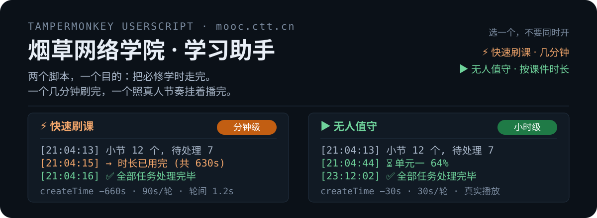
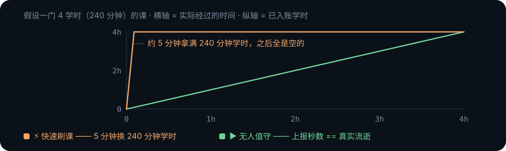
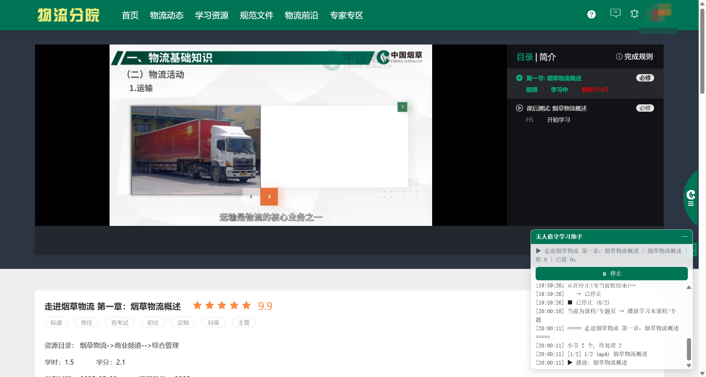

## 这个脚本做什么

跑在 `mooc.ctt.cn` 页面里，复用你自己的登录态，把「我的任务」里的必修课程逐小节上报到 100%。

它只做一件事：**把每轮上报的时长攒得比真实时间快**。开始学习时把 `createTime` 挪到过去
（当前时间减去 `单档秒数 + 60~300s`），服务端按日志年龄算额度，于是每一轮都有整档额度可用；
轮与轮之间只歇 0.6~1.6 秒，而不是真的等满一轮时长。所以一门 4 学时的课几分钟就走完。

不播放课件、不伪造播放进度——**只提交学习时长**，完成判定按累计学时算，跟播放器进度无关。

## 装之前

1. 装一个用户脚本管理器：[Tampermonkey](https://www.tampermonkey.net/) / Violentmonkey / ScriptCat 都行。
2. Chrome 138 起，用户脚本是独立开关：打开 `chrome://extensions` → 找到扩展 →「详情」→
   打开 <mark>允许运行用户脚本</mark>。不开这一步，脚本装上了也不会执行，而且不会报错。
3. 在浏览器里正常登录 `mooc.ctt.cn`，确认能自己打开课程页面。

## 怎么用

- 打开 `mooc.ctt.cn` 任意页面，右下角出现悬浮面板。
- 面板会先看当前地址：停在**课程/专题详情页**就只处理这一门，否则拉「我的任务」列表按课推进。
- 点 <kbd>执行学习任务</kbd> 开始，随时点 <kbd>停止</kbd>。停止是等当前这一轮报完再退，不会留下半条日志。
- 全部处理完会在 2 秒后自动刷新页面，让进度条落到新值上。

token 不用填，账号密码也不用填。脚本只借用**你已经在网页上登录好的那次会话**：
先读 `localStorage.token`，读不到就挂钩页面自己的 `XMLHttpRequest` / `fetch`，
从页面发出的请求里截 `Authorization`。**页面先正常发一次请求，脚本才拿得到令牌**——
所以第一次点开始前，先随手点开一个课程页，别停在登录页。

脚本不收集、不保存、也不代你登录。登录态失效时它会直接停下报「登录态失效」，
在页面里重新登录一次、刷新，再点开始即可。

## 面板与菜单

  

  

  

面板可拖拽、可折叠，位置和折叠状态记忆在本机。状态行依次是 `课程 | 小节 | 轮 n | 已报 Ns`，
下面是滚动日志（保留最近 60 行）。标题栏颜色取自页面自身顶栏，浅色底自动换深色字。

| 油猴菜单项 | 作用 |
| :-- | :-- |
| 显示/隐藏面板 | 面板被点没了、或者想临时收起来 |
| 设置单档秒数(≥30) | 每轮上报的秒数，默认 `600`，低于 30 直接拒收 |

## 参数与硬上限

| 项目 | 值 | 说明 |
| :-- | :-- | :-- |
| 单档秒数 | 默认 600s，可调 ≥30 | 菜单里改，即 `createTime` 的回填基准 |
| `createTime` 回填 | 单档秒数 + 60~300s 随机 | 让日志年龄始终大于本轮上报时长 |
| 单轮实际上报 | ≤90s | 平台硬上限，实测 ≥120s 会被**静默丢弃**（HTTP 200 但不入账） |
| 轮间等待 | 0.6~1.6s | 快就快在这里 |
| 课与课间隔 | 1.5~3s 随机 | |
| 每轮提交后 | 刷新一次课程进度 | 尽量让服务端读数一致 |

所以「600s/轮」指的是回填档位，不是单轮提交时长。别把单档秒数当成一次能提交的上限去调大，
90s 那道墙在服务端。

## 能刷 / 会跳过

- **能刷**：`mp4`(6)、`mp3`(5)、`pdf`(1)、`epub`(7)、外链(3)、图片(2)、关联课程(10，递归两层，子课刷完再结算父记录)
- **跳过**：考试(9)、问卷(12)、评估(13) —— 需要真实作答；`scorm`(4)、任务(8)、课件(15) —— 暂无上报协议
- 已完成的（`finishStatus ∈ {2,4}`）直接略过，不重复提交

## 常见问题

面板一直不出现

多半是当前页面不是 `mooc.ctt.cn`，或者停在 `#/login`、`#/register` 这类登录页——登录页不挂面板。
另外确认扩展里那个「允许运行用户脚本」已经打开。

日志停在「等待令牌」

页面还没自己发过带 `Bearer` 的请求。手动点开任意课程/我的任务页，让页面正常请求一次，
脚本截到令牌就会自己继续。等够久会超时退出，重新点开始即可。

报 401 或 errorCode 90901 / 90902

登录态失效（`401` 或 `errorCode` 为 `90901` / `90902`）。脚本会先回读 `localStorage`
看有没有新令牌，有就重试一次；没有就停下。**在页面里重新登录、刷新，再点开始**——
它本来就不碰账号密码，不负责替你登。

提示「剩余时长未下降 —— 当日学时配额已满」

连续两轮剩余时长没有减少，说明平台已经不给入账了（学时按日累计，上限 24 小时）。
脚本会停下，不会硬刷。等次日再跑。

报了，但课程进度没动

两种可能：一是单轮提交超过 90s 被静默丢弃；二是平台开了 `enableUnique=1` 多端检测，
同一账号还有别处在学。先确认没在手机、别的浏览器上同时挂。

提示「另一个标签页的学习脚本正在运行」

两个脚本共用一把会话锁：同页互斥，跨标签页 45 秒内防多开。关掉多余的标签页，
或者等 45 秒锁过期再点开始。

## 边界与风险

- 自动化脚本存在账号风控风险，学时也可能被平台撤销，**后果自负**。
- 平台规则随时可能收紧。这套方案依赖 `createTime` 由客户端提供，一旦改成服务端时钟就整体失效。
- 仅供个人账号的学习进度管理与协议研究，不得用于代刷、售卖或商业用途。
