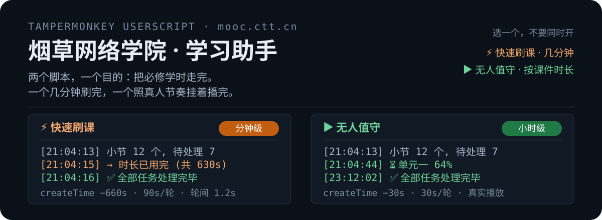
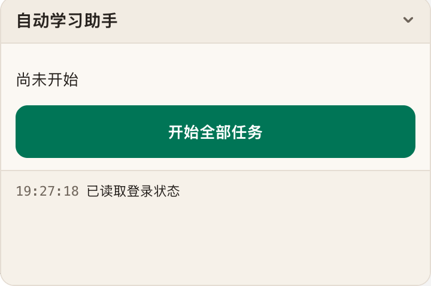
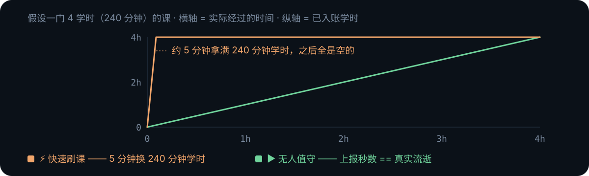

## 这个脚本做什么

同样跑在 `mooc.ctt.cn`，同样复用你自己的登录态，但它**只驱动页面，不代报进度**：

  

- 真实打开课件、真实播放，学时由平台的播放器自己记；
- 一个上报请求都不发——`start-progress`、`video-progress`、`doc-progress` 全不碰；
- 非视频小节（文档、外链、图像）只负责打开，然后等平台自己记上。

也就是说，从平台侧看就是有人开着页面一集一集往下看：学时与真实时间 1:1 增长，
一门 4 学时的课就要 4 小时。它不追求快。

需要真实作答的考试、问卷、评估会直接跳过；页面长时间挂着会保活。
挂在后台标签页里就行，不用盯着。

## 装之前

1. 装一个用户脚本管理器：[Tampermonkey](https://www.tampermonkey.net/) / Violentmonkey / ScriptCat 都行。
2. Chrome 138 起，用户脚本是独立开关：打开 `chrome://extensions` → 找到扩展 →「详情」→
   打开 <mark>允许运行用户脚本</mark>。不开这一步，脚本装上了也不会执行，也不会报错。
3. 在浏览器里正常登录 `mooc.ctt.cn`，确认能自己打开课程页面。

> 不要和「快速学习助手」同时启用。两者共用一把会话锁，会互相拒启动。

## 怎么用

- 打开 `mooc.ctt.cn` 任意页面，右下角出现悬浮面板，点 <kbd>开始本课程</kbd> 或 <kbd>开始全部任务</kbd>。
- 停在课程/专题详情页时只处理这一门；否则按「我的任务」列表逐课推进。
- 想挂着过夜，就把标签页留在后台，并把油猴菜单里的 <mark>自动续跑</mark> 打开——
  刷新、翻页、跳到新的课程页之后它会自己接着跑。

`localStorage` 里有现成令牌时，启动就能直接读到，不必等页面发请求；读不到才需要手动打开一个课程页，
让页面发一次请求，脚本才截得到 `Authorization`。脚本不收集、不保存账号密码，也不代你登录——只借用你已经在网页上登录好的会话。
登录态失效时它会停下报错，在页面里重新登录一次、刷新，再点开始即可。

## 面板与菜单

面板可拖拽、可折叠，位置和折叠状态记忆在本机。暖纸底、强调色取自宿主导航栏，没有毛玻璃和阴影。从上到下三块：

- **进度区**（按钮上方）：课程名、`小节 1/4，课程 2/3`、当前小节。
- **按钮**：既是操作入口也是进度条，未完成部分压暗，已完成部分从左往右填充，文字给出状态与百分比：
  `开始本课程` / `开始全部任务` → `学习中 45%`（悬停或键盘聚焦显示 `停止 45%`）→ `继续学习 45%` → `已完成`。
  触屏无 hover 时运行态直接显示停止；停止中固定显示 `正在停止…`。
  播放中的小节按播放器实际位置刷新，日志里每 20% 打一条进度。
  副行是 `第 3 轮，已播放 4 分 30 秒 / 共 10 分钟，约 5 分钟，一杯咖啡`：前两个数字是播放器当前位置和视频时长，后面是 1:1 播放下的剩余时间与体感参照。
- **日志区**（按钮下方）：滚动保留最近 60 行，时间戳压暗，课程分隔行加粗。

标题栏右侧仍显示状态与百分比（如 `学习中 45%`）。未登录时按钮显示 `去登录`，点击进入登录页，不会空等。

下图是真实账号登录后、脚本已读取到令牌的初始态；截图只保留面板，不含账号、姓名与令牌信息。

  

| 油猴菜单项               | 作用                                                 |
| :----------------------- | :--------------------------------------------------- |
| 显示/隐藏面板            | 面板被收起来了                                       |
| 自动续跑: 开/关（当前…） | 刷新或翻页后自动继续，默认**关**；打开会重载一次页面 |

## 节奏与保活

  

| 项目              | 值                                                          |
| :---------------- | :---------------------------------------------------------- |
| 进度上报          | 不发送，全部由平台播放器/阅读器自己记                        |
| 轮间等待          | 不适用，播放到哪就是哪                                      |
| 课与课间隔        | 3~6s 随机                                                   |
| 播放进度轮询      | 每 10s 查一次                                               |
| 暂停续播          | 运行中播放器暂停且进度两轮没动 → `play()` 续播；点击停止会同步 `pause()` 且不再续播 |
| 屏幕保活          | `navigator.wakeLock` 请求 screen 锁，页面重新可见时再续     |
| 非视频小节        | 打开后最多等 120s 让平台自己记；记不上就落下一条日志继续     |
| 播放器设置        | 自动静音、音量归零、画质切到「普清」（每首资源最多试 2 次） |

完成判定看两处：小节 `finishStatus` 命中完成态，或者播放器播到底。
因为不代报，平台不记账时（例如当日学时到顶）不会报错，只会等超时后落下一条「平台未记录完成」。
播到底之后脚本还会再等最多 40s 轮询 `finishStatus`，确认平台已经结算才继续——平台写库比播放器慢，立刻刷新会看到「播了但学时没涨」。
关联课程（专题里套的课）播完后，脚本会打开父课程页，最多等 30s 让平台自己结算。

## 能刷 / 会跳过

- **能刷**：`mp4`(6)、`mp3`(5)、`pdf`(1)、`epub`(7)、外链(3)、图片(2)、关联课程(10，子课播完后打开父页等平台结算)
- **跳过**：考试(9)、问卷(12)、评估(13) —— 需要真实作答，脚本不碰；`scorm`(4)、任务(8)、课件(15) —— 页面里打不开或平台不记账
- 已完成的（`finishStatus ∈ {2,4}`）直接略过

跳过不是失败：日志里会写「跳过」，整门课的其他小节照常推进。

## 常见问题

面板一直不出现

当前页面不是 `mooc.ctt.cn`，或者停在 `#/login`、`#/register` 这类登录页——登录页不挂面板。
再确认扩展里的「允许运行用户脚本」已经打开。

一直提示「播放页未出现播放器」

播放器 20 秒内没加载出来。多半是网络慢、或者这个课件类型本来就不给播放器（看日志里的类型）。
刷新页面重来一次；连着失败就换一门课先跑。

播放器静音了、画质也被改了

故意的。静音 + 普清是为了少占带宽、并在后台标签页里稳定推进，不影响平台记录。
想调回来就停掉脚本自己改，下一次轮询它还会再设回去。

报 401 或 errorCode 90901 / 90902

登录态失效（`401` 或 `errorCode` 为 `90901` / `90902`）。脚本会先回读 `localStorage`，
有新鲜令牌就重试一次，没有就停下。**在页面里重新登录、刷新，再点开始**——
它不碰账号密码，不负责替你登。

提示「平台未记录完成, 已放弃」

脚本只负责把课件打开、播完，不替你上报，所以平台不记账时它也无计可施。
常见两种原因：当日学时到顶（平台按日累计，上限约 24 小时），或者这个课件的阅读器要在页面上真互动才累计。
等次日，或者切到「快速刷课」那个脚本处理这一节。

挂后台会被浏览器挂起 / 进度变慢

脚本会申请 `wakeLock`，运行中会在播放器被暂停时续播；点击停止会同步 `pause()`，停止请求期间不再续播。但浏览器对后台标签页的定时器本身有节流，
最稳的挂法是**把这个标签页单独放在一个窗口里不要最小化**，别跟几十个标签页挤在一起。

提示「另一个标签页的学习脚本正在运行」

会话锁：同页互斥，跨标签页 45 秒防多开。关掉多余标签页，或者等 45 秒再点开始。

## 边界与风险

- 与「快速学习助手」**互斥**，同一时间只开一个。
- 平台开了 `enableUnique=1` 检测多端同时学习——同一账号不要在多台设备、多个浏览器上同时跑。
- 自动化脚本存在账号风控风险，学时也可能被撤销，**后果自负**。
- 平台规则随时可能收紧；接口一变，脚本就可能整体失效。
- 仅供个人账号的学习进度管理与协议研究，不得用于代刷、售卖或商业用途。
