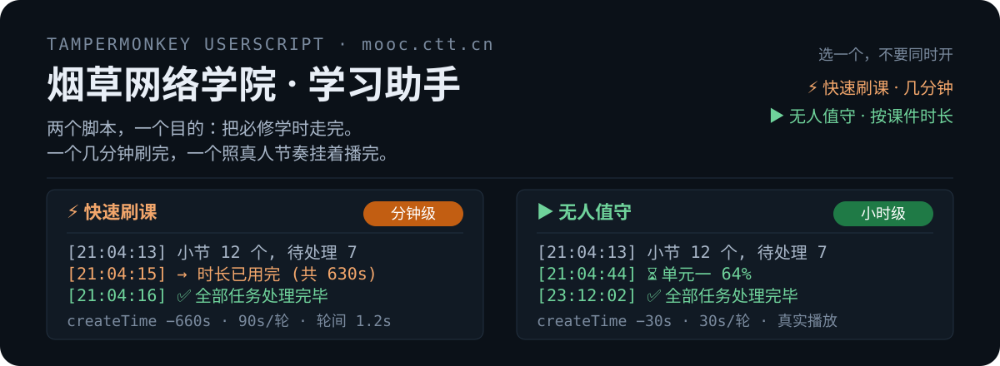
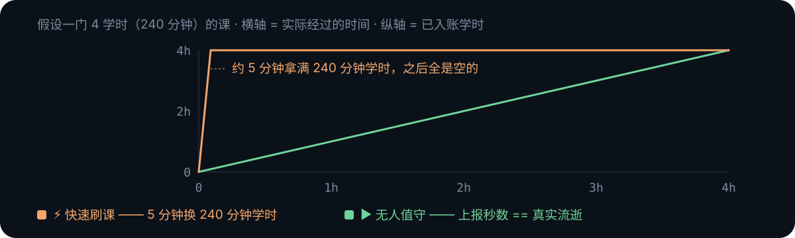
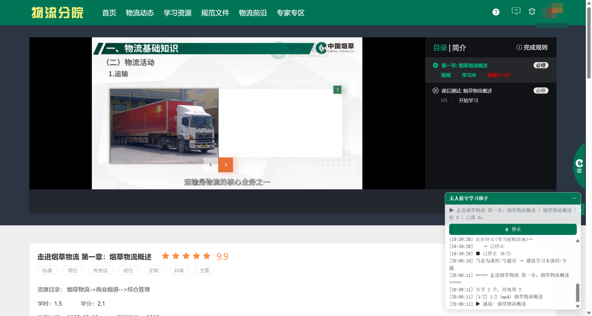

## 这个脚本做什么

同样跑在 `mooc.ctt.cn`，同样复用你自己的登录态，但节奏是**真实的**：

- 真实打开课件、真实播放；
- 每轮上报 `studyTime = 30s`，`createTime` 也只回填 30s —— 压根不多要；
- 轮与轮之间**真的等满 30 秒**才报下一轮。

也就是说，学时和真实时间 1:1 增长：一门 4 学时的课就要 4 小时。它不追求快，
追求的是从平台侧看，「这条学习记录」和一个人坐在电脑前看课件没有区别。

需要真实作答的考试、问卷、评估会直接跳过；页面长时间挂着会保活。
挂在后台标签页里就行，不用盯着。

## 装之前

1. 装一个用户脚本管理器：[Tampermonkey](https://www.tampermonkey.net/) / Violentmonkey / ScriptCat 都行。
2. Chrome 138 起，用户脚本是独立开关：打开 `chrome://extensions` → 找到扩展 →「详情」→
   打开 <mark>允许运行用户脚本</mark>。不开这一步，脚本装上了也不会执行，也不会报错。
3. 在浏览器里正常登录 `mooc.ctt.cn`，确认能自己打开课程页面。

> 不要和「快速刷课学习助手」同时启用。两者共用一把会话锁，会互相拒启动。

## 怎么用

- 打开 `mooc.ctt.cn` 任意页面，右下角出现悬浮面板，点 <kbd>执行学习任务</kbd>。
- 停在课程/专题详情页时只处理这一门；否则按「我的任务」列表逐课推进。
- 想挂着过夜，就把标签页留在后台，并把油猴菜单里的 <mark>自动续跑</mark> 打开——
  刷新、翻页、跳到新的课程页之后它会自己接着跑。

第一次点开始前，先手动打开一个课程页让页面发一次请求，脚本才截得到 `Authorization`。
脚本不收集、不保存账号密码，也不代你登录——只借用你已经在网页上登录好的会话。
登录态失效时它会停下报错，在页面里重新登录一次、刷新，再点开始即可。

## 面板与菜单

  

  

  

面板可拖拽、可折叠，位置与折叠状态记忆在本机。状态行是 `课程 | 小节 | 轮 n | 已报 Ns`，
下面滚动日志保留最近 60 行，能看到每一轮实际提交了多少秒。

| 油猴菜单项               | 作用                                                 |
| :----------------------- | :--------------------------------------------------- |
| 显示/隐藏面板            | 面板被收起来了                                       |
| 自动续跑: 开/关（当前…） | 刷新或翻页后自动继续，默认**关**；打开会重载一次页面 |

## 节奏与保活

| 项目              | 值                                                          |
| :---------------- | :---------------------------------------------------------- |
| 每轮上报          | 30s（`studyTime`）                                          |
| `createTime` 回填 | 30s —— 等于上报秒数                                         |
| 轮间等待          | 30s 真实流逝，然后才报下一轮                                |
| 课与课间隔        | 3~6s 随机                                                   |
| 播放进度轮询      | 每 10s 查一次                                               |
| 卡住唤醒          | 进度连续 4 次没变 → `pause()` → 0.5s → `play()` 重踢一次    |
| 屏幕保活          | `navigator.wakeLock` 请求 screen 锁，页面重新可见时再续     |
| 播放器小动作      | 每 12s 在播放器上补一次随机 `mousemove` / `pointermove`     |
| 播放器设置        | 自动静音、音量归零、画质切到「普清」（每首资源最多试 2 次） |

完成判定看两处：小节 `finishStatus` 命中完成态，或者 `lessonLocation ≥ duration - 5`。
剩余时长连续两轮不下降，则判定当日学时配额已满（平台按日累计，上限约 24 小时），脚本停下等次日。

## 能刷 / 会跳过

- **能刷**：`mp4`(6)、`mp3`(5)、`pdf`(1)、`epub`(7)、外链(3)、图片(2)、关联课程(10，子课播完再结算父记录)
- **跳过**：考试(9)、问卷(12)、评估(13) —— 需要真实作答，脚本不碰；`scorm`(4)、任务(8)、课件(15) —— 暂无上报协议
- 已完成的（`finishStatus ∈ {2,4}`）直接略过

跳过不是失败：日志里会写「跳过」，整门课的其他小节照常推进。

## 常见问题

面板一直不出现

当前页面不是 `mooc.ctt.cn`，或者停在 `#/login`、`#/register` 这类登录页——登录页不挂面板。
再确认扩展里的「允许运行用户脚本」已经打开。

一直提示「播放页未出现播放器」

播放器 20 秒内没加载出来。多半是网络慢、或者这个课件类型本来就不给播放器（看日志里的类型）。
刷新页面重来一次；连着失败就换一门课先跑。

播放器静音了、画质也被改了

故意的。静音 + 普清是为了少占带宽、并在后台标签页里稳定推进，不影响上报。
想调回来就停掉脚本自己改，下一次轮询它还会再设回去。

报 401 或 errorCode 90901 / 90902

登录态失效（`401` 或 `errorCode` 为 `90901` / `90902`）。脚本会先回读 `localStorage`，
有新鲜令牌就重试一次，没有就停下。**在页面里重新登录、刷新，再点开始**——
它不碰账号密码，不负责替你登。

提示「剩余时长未下降 —— 当日学时配额已满」

平台不给入账了（按日累计上限约 24 小时）。停下等次日，硬刷没有意义。

挂后台会被浏览器挂起 / 进度变慢

脚本会申请 `wakeLock` 并每 12 秒给播放器补一次鼠标事件。但浏览器对后台标签页的定时器本身有节流，
最稳的挂法是**把这个标签页单独放在一个窗口里不要最小化**，别跟几十个标签页挤在一起。

提示「另一个标签页的学习脚本正在运行」

会话锁：同页互斥，跨标签页 45 秒防多开。关掉多余标签页，或者等 45 秒再点开始。

## 边界与风险

- 与「快速刷课学习助手」**互斥**，同一时间只开一个。
- 平台开了 `enableUnique=1` 检测多端同时学习——同一账号不要在多台设备、多个浏览器上同时跑。
- 自动化脚本存在账号风控风险，学时也可能被撤销，**后果自负**。
- 平台规则随时可能收紧；接口一变，脚本就可能整体失效。
- 仅供个人账号的学习进度管理与协议研究，不得用于代刷、售卖或商业用途。
